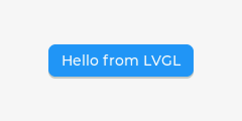

# Your first program

This program draws a button with a label on a 240 by 120 display and handles
one click. It needs no screen: LVGL draws into a buffer you hand it, and a
flush callback tells you when a frame is ready. That is the same shape on a
desktop, in firmware, and in a test.

```python
import lvgl as lv

lv.init()
disp = lv.display_create(240, 120)
disp.set_color_format(lv.COLOR_FORMAT.RGB565)
buf = bytearray(240 * 120 * 2)
disp.set_buffers(buf, None, len(buf), lv.DISPLAY_RENDER_MODE.FULL)
flushed = []
disp.set_flush_cb(lambda d, area, px: (flushed.append(area.get_width()), d.flush_ready()))

button = lv.button(lv.screen_active())
button.center()
label = lv.label(button)
label.set_text("Hello from LVGL")
button.add_event_cb(lambda e: print("clicked"), lv.EVENT.CLICKED, None)
button.send_event(lv.EVENT.CLICKED, None)

lv.tick_inc(50)
lv.refr_now(disp)
print(label.get_text(), "- drew", flushed[-1], "px wide")
```

Save it as `hello.py`. Run it with `python hello.py` on CPython,
`micropython hello.py` on a MicroPython-compatible interpreter, or
`circuitpython hello.py` on a CircuitPython-compatible one. Each prints the
same thing:

```text
clicked
Hello from LVGL - drew 240 px wide
```

## What each part does

`lv.display_create(240, 120)` makes a display of that size, and
`set_buffers` gives it a buffer to draw into. `DISPLAY_RENDER_MODE.FULL`
redraws the whole frame each time, so the buffer is `240 * 120 * 2` bytes for
16-bit color.

`set_flush_cb` registers the function LVGL calls when it has pixels for you.
On a real display you would copy `px` to the panel there. Calling
`d.flush_ready()` tells LVGL the copy is done.

Every widget takes its parent: `lv.button(lv.screen_active())`,
then `lv.label(button)`. `add_event_cb` attaches a handler, and `send_event`
fires one by hand so the example needs no pointer.

LVGL keeps time from the ticks you give it. `lv.tick_inc(50)` says 50 ms have
passed, and `lv.refr_now(disp)` draws now instead of waiting for the next
`lv.timer_handler()`.

## See the frame

The buffer holds the finished frame. With Pillow, add these lines to turn it
into a PNG:

```python
from PIL import Image
Image.frombytes("RGB", (240, 120), bytes(buf), "raw", "BGR;16").save("hello.png")
```



## On a board

On a board, [pydevices](https://github.com/PyDevices/pydevices) supplies a
`display_driver` module that creates the display from your board
configuration, feeds LVGL its ticks and input, and keeps the screen updating.
Import it before `lvgl`, then build widgets on `lv.screen_active()` as above.
[Using LVGL with PyDevices](https://github.com/PyDevices/pydevices/blob/main/docs/guides/lvgl.md)
covers what it does and how its timers behave. Keep every `lvgl` call on one
thread: [Use LVGL from threads](../guides/use-lvgl-from-threads.md).
